<div align="center">

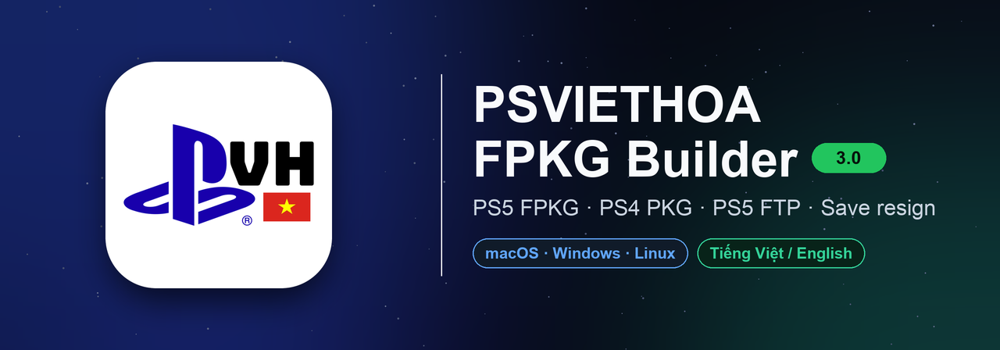

🇻🇳 Tiếng Việt: [docs/README.vi.md](docs/README.vi.md)

**One desktop app for the whole PlayStation homebrew workflow: build PS5 FPKGs, pack PS4 PKGs, move files to the PS5 over FTP and resign PS4 / PS5 saves — on macOS, Windows and Linux.**

<a href="https://github.com/thanhsondev/PSVIETHOA-FPKG-Builder/releases/latest"></a>


</div>

<p align="center">
  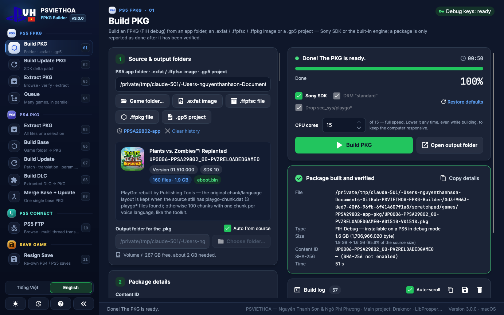
  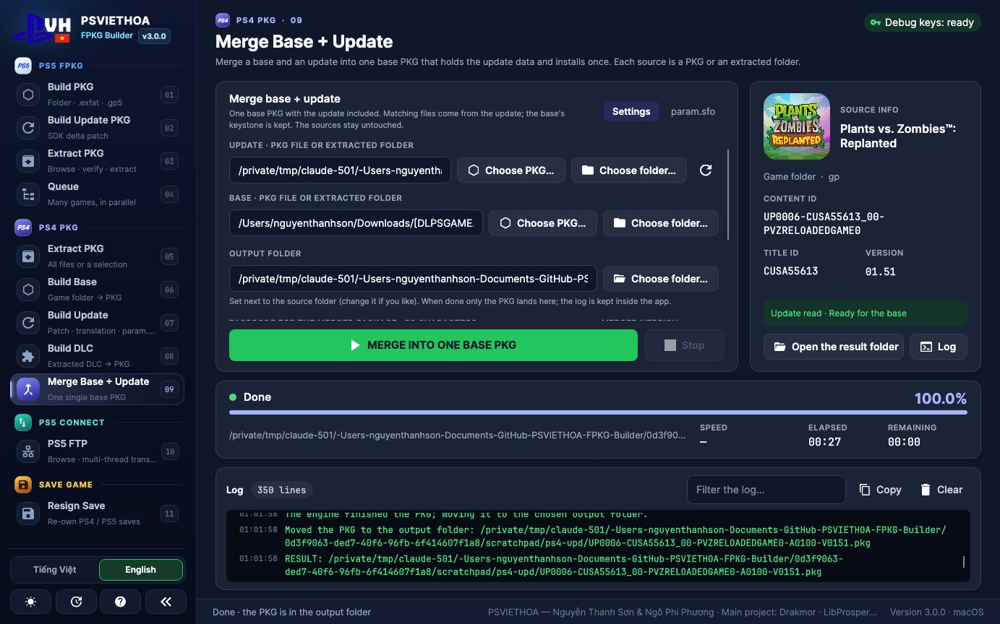
</p>
<p align="center">
  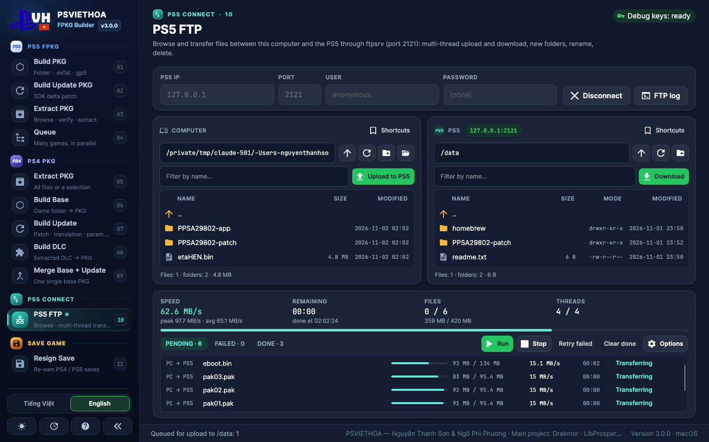
  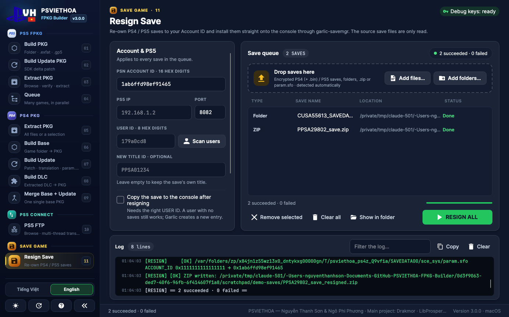
</p>

<div align="center">

**Credits:** PSVIETHOA — Nguyễn Thanh Sơn & Ngô Phi Phương · **Main project:** Drakmor (LibProsperoPkg) · PS4, FTP & save tools ported from **PSVIETHOA STUDIO** (Ngô Phi Phương)

</div>

---

## What's in the box

| | Page | What it does |
|---|---|---|
|  | **Build PKG · Build Update PKG · Extract PKG · Queue** | PS5 FPKG (FIH debug) from an app folder, an `.exfat` / `.ffpfsc` / `.ffpkg` image or a `.gp5` project — through **Sony's Publishing Tools 2.79** (default) or Drakmor's **LibProsperoPkg** engine. Delta updates against an installed base, package inspection / extraction, parallel build queue. *Unchanged from 2.2.7.* |
|  | **Extract PKG · Build Base · Build Update · Build DLC · Merge Base + Update** | PS4 fake PKGs with **orbis-pub-cmd 3.87** (CyB1K patch) and **LibOrbisPkg**, following the PSVIETHOA STUDIO workflow. Live preview of the game (icon, title, Content ID, version), `param.sfo` editor, per-file extraction. |
|  | **Pack ZSTD · Unpack ZSTD · Patch ZSTD** *(beta)* | ps5-dump-forge ZSTD packs with the **ampr-emu-ng 0.3.4** runtime: the game shrinks to about half, unpacks byte-exact, and translations can be patched into a packed game without unpacking it (Vietnamese UI). |
|  | **PS5 FTP** | Two-pane file manager for the PS5's FTP server (ftpsrv, etaHEN…): drag files between the panes or from Finder / Explorer, multi-connection transfers with resume, rename / delete / new folder, saved consoles. |
|  | **Resign Save** | Re-own PS4 / PS5 saves to your Account ID. Decrypted saves are fixed right on the computer; encrypted ones go through **garlic-savemgr** on the PS5 (the app loads it for you). |

> PS5 packages are **debug FPKGs** (FIH image, signature byte `0x00`) and PS4 packages are **fake PKGs** — they install only on consoles running the matching homebrew. The source folders, images and packages you pick are only ever **read**.

## What's new in 3.0

- **A new home.** A redesigned sidebar groups everything by console: **PS5 FPKG**, **PS4 PKG**, **PS5 Connect** and **Save Game**, each page numbered (01–11) with its own accent colour. A compact mode keeps only the icons. New **PSVH logo** and app icon on every platform. Vietnamese is the default language; English is one click away and every string — UI, logs, CLI help — exists in both.
- **PS4 PKG, the PSVIETHOA STUDIO way.** Five pages ported from PSVIETHOA STUDIO 1.7.0 by Ngô Phi Phương — the same mechanism, not a PS5 look-alike:
  - **Extract PKG** opens the PFS with the passcode, or recovers the FPKG key when the passcode is unknown (LibOrbisPkg's `GetEkpfs`, including the KDF compat flag). Extracts everything or only the files you tick into `CUSAxxxxx-base / -update / -dlc` folders (`image0` + `Sc0`).
  - **Build Base / Build Update / Build DLC** generate a GP4 project exactly like the Studio: same exclusions (`playgo-*`, `license.*`, `origin-deltainfo`, `pubtoolinfo`…), `pfs_compression` on every file, the source PlayGo layout, a staged `param.sfo` with CATEGORY / APP_VER / VERSION patched in place. Updates are retargeted to the base's Content ID and borrow its `nptitle` / `npbind`; a base locked with another passcode still works through a stub reference package. DLC entitlement keys are read from the debug licence, `dlc_rebuild.json`, the GP4 or `license.dat`.
  - **Merge Base + Update** builds one base PKG that already holds the update (update files win, the keystone comes from the base, APP_VER 01.00, VERSION from the update).
  - `orbis-pub-cmd` runs natively on Windows and through Wine on macOS / Linux. The **fast engine** (Studio patch: no reference-integrity precheck, no base delta scan) is the default; **Full mode** switches to the original binary with full digests.
  - The right-hand card previews the game as soon as you pick it: icon, title, Content ID, Title ID, version, category and whether the passcode matches. The **param.sfo** tab edits the title (all languages at once), version and any other field before packing — the edited copy is saved apart from the source.
- **PS5 FTP.** Connect to the console's FTP server (user and password empty by default; the password is never saved). Drag files and folders from one pane to the other, from Finder / Explorer into the PS5 pane, or onto a folder to send them straight into it; drag PS5 files onto another PS5 folder to move them. The queue picks how many files run in parallel, splits large files over several connections (segmented `REST` download), keeps an ETA from a least-squares speed model and retries / resumes after a drop. Pending / Failed / Done tabs, a raw FTP command log, keyboard shortcuts (Enter, Delete, F2, F5, Backspace).
- **Resign Save.** Drop folders, `.zip`, `param.sfo` or encrypted save images; the type is detected from the content. Decrypted saves are resigned offline (`ACCOUNT_ID`, optional `TITLE_ID`, a `.bak` of the original `param.sfo`; a `.zip` gets a new `_resigned.zip`). Encrypted PS4 / PS5 saves are decrypted, resigned and installed through **garlic-savemgr** (earthonion): **Load ELF** sends the bundled build to the ELF loader (port 9021), **Scan users** lists the console's accounts, **Take a save from another user** copies a save between the console's users, and a backup of any save about to be overwritten is downloaded first.
- **CLI:** new `ps4-info`, `ps4-list`, `ps4-extract`, `ps4-base`, `ps4-patch`, `ps4-dlc`, `ps4-merge`. `fpkg-cli info` reports whether the PS4 tools can run (Wine 32-bit / VC++ x86).
- **PS5 FPKG keeps the 2.2.7 mechanism byte-for-byte** (Sony SDK toolkit `sdk279-plaintext-direct-v3`, LibProsperoPkg from fpkg-gui 0.6.12) — the same game builds to the same 1,706,966,020-byte package as 2.2.7. The page itself is easier to use: *Auto from source* is on, and picking another game switches the output folder back to it so packages never land in the previous game's folder; the right column scrolls, so the build log stays readable (at least 280 px) while the result card is shown; buttons say what they pick (*Game folder…*, *Choose PKG…*, *Choose folder…*).

Earlier releases: see [CHANGELOG.md](CHANGELOG.md) — the 2.2 line brought Sony Publishing Tools builds, update packages, the build queue, online metadata restore and the PlayGo / DLC-emulator fixes.

## Download & run

Grab the archive for your platform from [**Releases**](https://github.com/thanhsondev/PSVIETHOA-FPKG-Builder/releases/latest). Every build is **self-contained** (no .NET install) and also contains the `fpkg-cli` command-line tool.

| Platform | Archive | Notes |
|---|---|---|
| **macOS** Apple Silicon / Intel | `…-macOS-AppleSilicon.zip` / `…-macOS-Intel.zip` | Right-click the app → **Open** the first time (ad-hoc signed). Wine is bundled (with 32-bit support for PS4). Apple Silicon needs Rosetta 2 — the app offers to install it. |
| **Windows** x64 | `…-Windows-x64-Setup.exe` or `.zip` | The installer adds Dokan (copy-free image mounting) and the Visual C++ runtimes: x64 for the Sony SDK, **x86 2008 SP1 + 2015–2022 for PS4**. The portable zip installs what is missing on first use (UAC prompt). |
| **Linux** x64 / arm64 | `…-Linux-x64.tar.gz` / `…-Linux-arm64.tar.gz` | Run `app/PsViethoa.FpkgBuilder.App` (`./install-desktop-entry.sh` adds a menu entry). Sony SDK and PS4 builds use your distro's Wine — for PS4 it needs 32-bit support (`wine32` / `wine:i386`). |

## Quick start

**PS5 FPKG** — *Build PKG*: pick the app folder (or an `.exfat` / `.ffpfsc` / `.ffpkg` / `.gp5`), check the detected Content ID and version, press **Build PKG** (`Ctrl/⌘+B`). The package is verified before it is reported as done. *Build Update PKG* does the same against the base `.pkg` installed on the console.

**PS4 PKG** — choose the page (Extract / Base / Update / DLC / Merge), drop the source `.pkg` or game folder (and the base for Update / Merge). The preview card fills in, the output folder is set next to the source, and the green button (*Start extracting*, *Build the base PKG*…) runs the job. Change the version or the title in the *param.sfo* tab first if you need to.

**PS5 FTP** — start an FTP server on the PS5 (ftpsrv listens on port 2121; use your server's port otherwise), type its IP, **Connect**, then drag files across.

**Resign Save** — enter your 16-digit Account ID (and the PS5 IP + User ID to install encrypted saves), drop the saves, **Resign all**.

## Command line

```bash
fpkg-cli info                                        # which components work on this machine (SDK, Wine, PS4 tools, keys…)

# PS5 FPKG
fpkg-cli build --source "/games/PPSA12345-app" --output "/out"
fpkg-cli build --source "/games/PPSA12345-update" --sdk-reference "/out/PPSA12345-base.pkg" --output "/out"
fpkg-cli pkg-extract "/out/UP9000-PPSA12345_00-XXXX-A0100-V0100.pkg" --output "/unpacked" --include "sce_sys/**"

# PS4 PKG
fpkg-cli ps4-info  "/games/CUSA12345.pkg"
fpkg-cli ps4-extract "/games/CUSA12345.pkg" --output "/unpacked"
fpkg-cli ps4-base  "/unpacked/CUSA12345-base" --output "/out"
fpkg-cli ps4-patch "/unpacked/CUSA12345-update" --base "/games/CUSA12345.pkg" --output "/out" --version 01.51
fpkg-cli ps4-merge "/games/CUSA12345-patch.pkg" --base "/games/CUSA12345.pkg" --output "/out"
fpkg-cli ps4-dlc   "/unpacked/CUSA12345-dlc" --output "/out"
```

`fpkg-cli --help` lists every option (`--verify` for the full PS4 engine, `--gp4-only`, `--only <path>`, `--sfo <file>`, `--passcode`, `--base-passcode`, `--entitlement-key`, …). Exit codes: `0` success · `1` invalid arguments · `2` failed · `3` cancelled. Set `FPKG_LANG=vi|en` for the language.

## Tested on real games

Every screenshot below is a real run of this build on an Apple-Silicon Mac (macOS 27, bundled Wine), with the owner's own dumps.

**PS5 — Plants vs. Zombies Replanted (`PPSA29802`, 1.9 GB, 160 files), Sony SDK path**

| Built and verified | Build log (scroll down) |
|---|---|
|  | 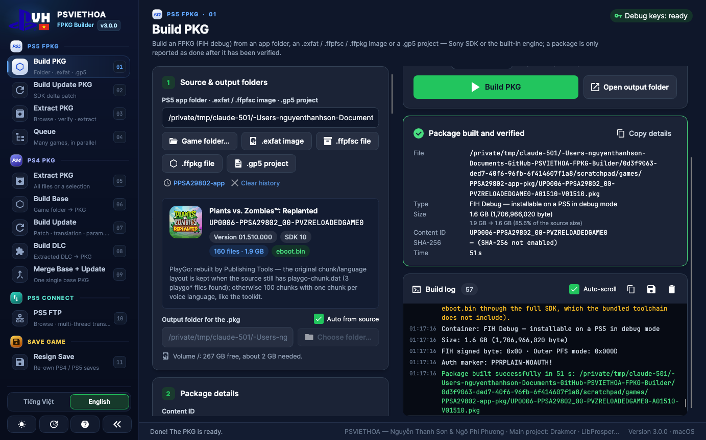 |

1.6 GB package (1,706,966,020 bytes), all six package checks passed. The CLI, the GUI and 2.2.7 produce the same size.

**PS4 — Plants vs. Zombies Replanted (`CUSA55613`, base 1.00 + update 1.51), orbis-pub-cmd through Wine**

| Build Update (from the extracted 1.51 update + the base PKG) | Merge Base + Update |
|---|---|
| 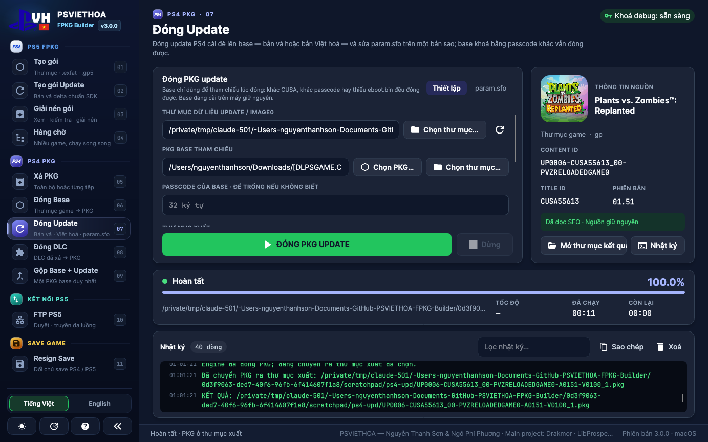 |  |

| Job | Result | Time |
|---|---|---|
| PS5 FPKG, Sony SDK | `PPSA29802` → 1.6 GB package, verified | 47–52 s |
| PS4 Extract PKG | 1.75 GB base → 351 files (156 MB update → 34 files) | 7 s |
| PS4 Build Update | 161,873,920-byte update PKG, same content as the original 1.51 update | 12 s |
| PS4 Build Base | 1,748,697,088-byte base PKG | 15 s |
| PS4 Merge Base + Update | one 1,748,697,088-byte base PKG with 1.51 inside (APP_VER 01.00, VERSION 01.51) | 27 s |
| PS5 FPKG, built-in engine, Standard | 21.3 GB game → 8.86 GiB (2.1 measurement) | 2 min 13 s |

The extracted files match the originals apart from the files the publishing tool regenerates, and the source PKGs keep their SHA-256. FTP and save resigning were tested against a local FTP server and sample saves (no console was connected for these screenshots).

## Build from source

Requires the [.NET SDK 10](https://dotnet.microsoft.com/download).

```bash
dotnet build PsViethoa.FpkgBuilder.slnx -c Release
dotnet test                                          # 550+ tests (real Sony SDK / PS4 builds run when Wine and the toolkits are present)
scripts/run-dev.sh                                   # GUI in Debug (macOS / Linux)
scripts/fetch-wine.sh                                # Wine for the Sony SDK and PS4 tools on macOS (keeps the 32-bit libraries)

scripts/publish-macos.sh osx-arm64 osx-x64           # .app + fpkg-cli + Wine + sony-sdk + orbis-pub, zipped
scripts/publish-windows.sh                           # exe, fpkg-cli, sony-sdk, orbis-pub, Dokan + VC++ x64/x86, Setup.exe with makensis
scripts/publish-linux.sh linux-x64 linux-arm64       # tar.gz with app/, fpkg-cli/, sony-sdk/, orbis-pub/
```

<details>
<summary>Project layout</summary>

```
src/PsViethoa.FpkgBuilder.Core/     PS5 engine & Sony SDK pipeline, Ps4/ (LibOrbisPkg + orbis-pub-cmd), Ftp/, Saves/, localization
src/PsViethoa.FpkgBuilder.App/      Avalonia UI (MVVM): sidebar shell, PS5 / PS4 / FTP / Save pages
src/PsViethoa.FpkgBuilder.Cli/      fpkg-cli
tests/PsViethoa.FpkgBuilder.Tests/  xUnit, synthetic fixtures only
libs/                               third-party, replaced only as a whole:
  LibProsperoPkg.dll                  PS5 engine (Drakmor)
  sony-sdk/                           Publishing Tools 2.79 toolkit
  LibOrbisPkg/                        PS4 PKG / PFS / SFO (Maxton, LGPL-3.0, source included)
  orbis-pub/                          PS4 Fake PKG Tools 3.87 (CyB1K), original + fast engine
  garlic-savemgr/                     PS5 save payload (earthonion), source included
  ampr/                               ampr-emu-ng 0.3.4 + ampr_emu 0.4.2.1 runtimes for ZSTD packs (GPL-3.0-or-later)
```
</details>

## Screenshots

| PS5 — Build PKG done (Vietnamese) | PS4 — game preview |
|---|---|
| 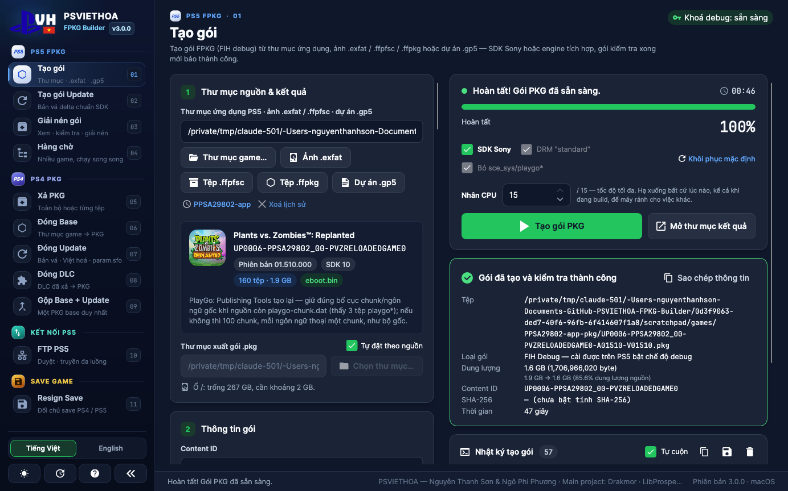 | 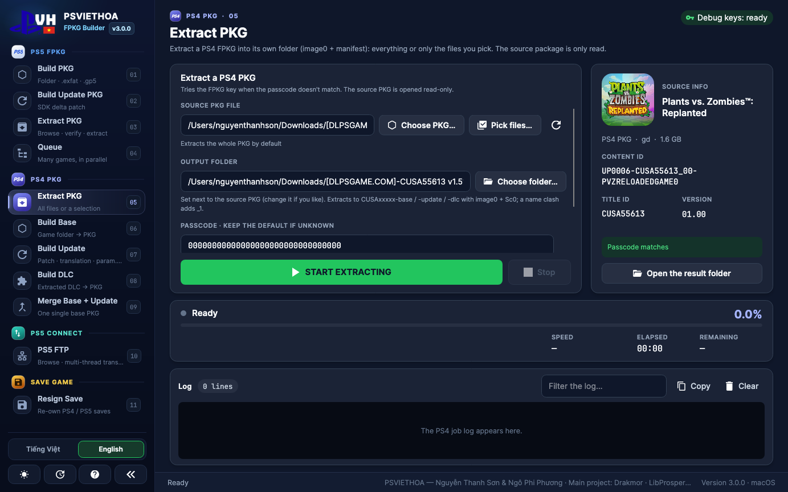 |

| PS4 — param.sfo editor (Vietnamese) | PS5 FTP (Vietnamese) |
|---|---|
| 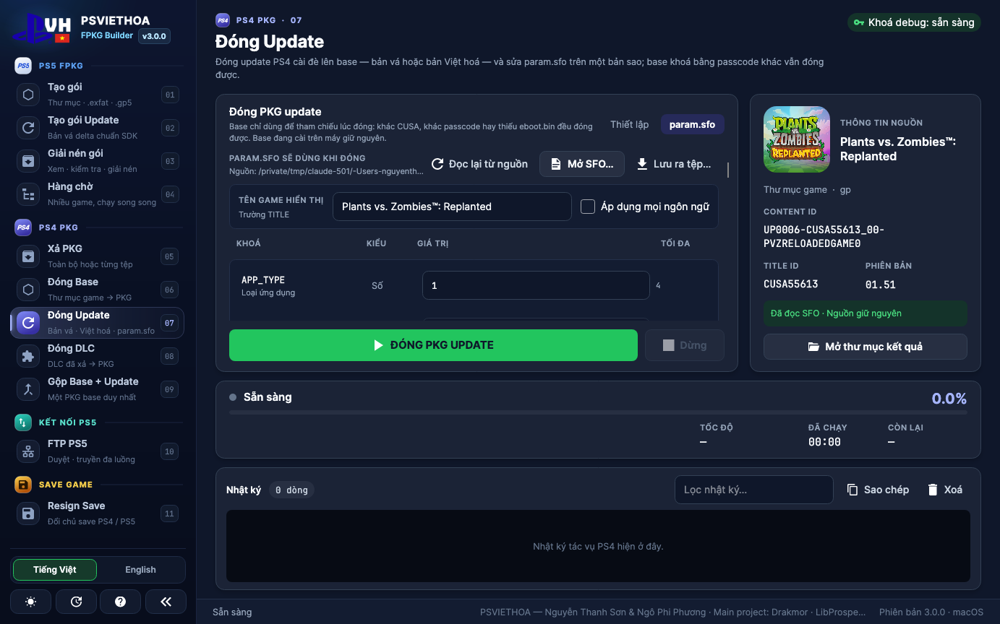 | 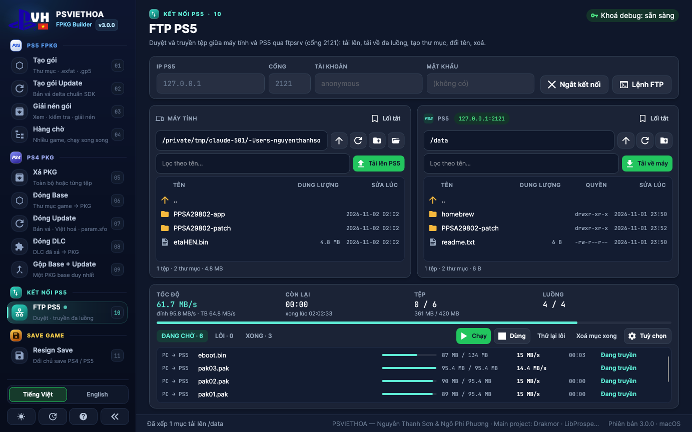 |

| Resign Save queue (Vietnamese) | Light theme |
|---|---|
| 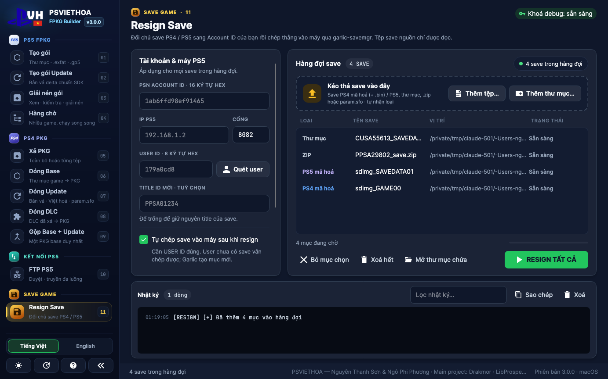 | 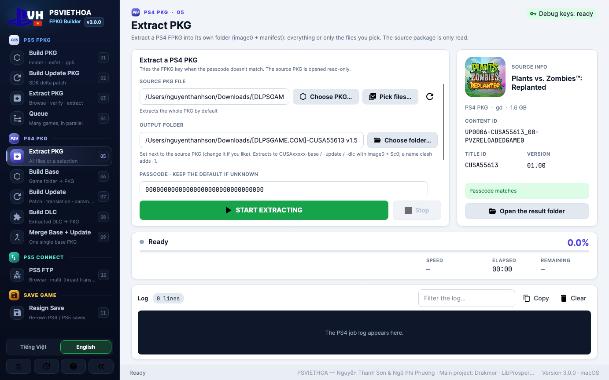 |

| Help — credits |
|---|
| 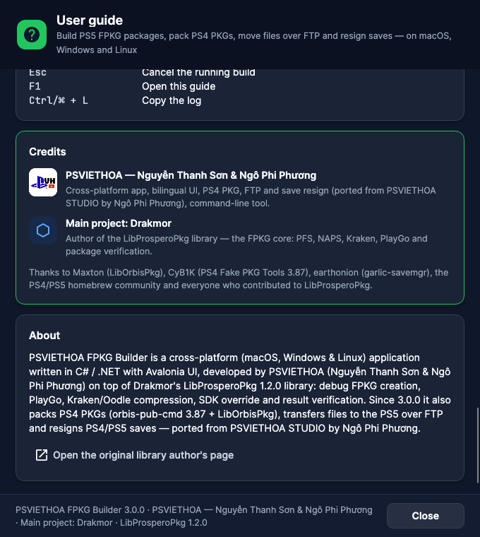 |

## Credits & license

- **PSVIETHOA — Nguyễn Thanh Sơn & Ngô Phi Phương** — the cross-platform app, UI, Sony SDK pipeline, CLI. The PS4 PKG, FTP and save-resign mechanisms come from **PSVIETHOA STUDIO** by **Ngô Phi Phương**.
- **Main project: Drakmor** — **LibProsperoPkg**, the PS5 FPKG engine (PFS, NAPS, Kraken, PlayGo, verification).
- **Maxton** — [LibOrbisPkg](https://github.com/maxton/LibOrbisPkg) (LGPL-3.0; the DLL is linked as a separate assembly and its source ships in `libs/LibOrbisPkg`).
- **CyB1K** — PS4 Fake PKG Tools 3.87 (`orbis-pub-cmd`).
- **earthonion** — garlic-savemgr (PS5 save payload).
- **quer3q** — [ps5-dump-forge](https://github.com/quer3q/ps5-dump-forge) (ZSTD pack format) and [ampr-emu-ng](https://github.com/quer3q/ampr-emu-ng); **drakmor** — [ampr_emu](https://github.com/drakmor/ampr_emu). All GPL-3.0-or-later; the runtimes ship unmodified in `libs/ampr`.
- [Wine](https://www.winehq.org/) (LGPL-2.1) runs the Windows toolkits on macOS / Linux; [Dokan](https://github.com/dokan-dev/dokany) mounts images on Windows.
- Fonts: JetBrains Mono & Inter (SIL OFL). Icons: Material Design Icons (Apache 2.0).

> The third-party binaries under `libs/` ship unmodified (the PS4 fast engine is the Studio's documented patch, `FAST_ENGINE_PATCH.json`). These tools are for homebrew and development on your own consoles — use them responsibly.

<div align="center">

Made with care by **PSVIETHOA** · 🇻🇳 · [psviethoa.com](https://psviethoa.com)

</div>
