<div align="center">

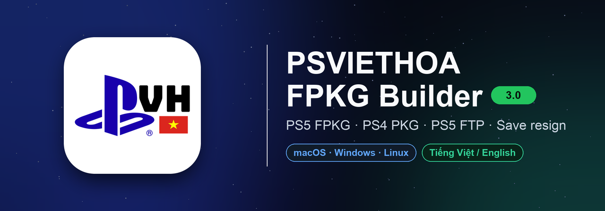

🇬🇧 English: [README.md](../README.md)

**Một ứng dụng cho cả quy trình homebrew PlayStation: tạo gói FPKG cho PS5, đóng gói PKG cho PS4, truyền tệp tới PS5 qua FTP và resign save PS4 / PS5 — trên macOS, Windows và Linux.**

<a href="https://github.com/thanhsondev/PSVIETHOA-FPKG-Builder/releases/latest"></a>


</div>

<p align="center">
  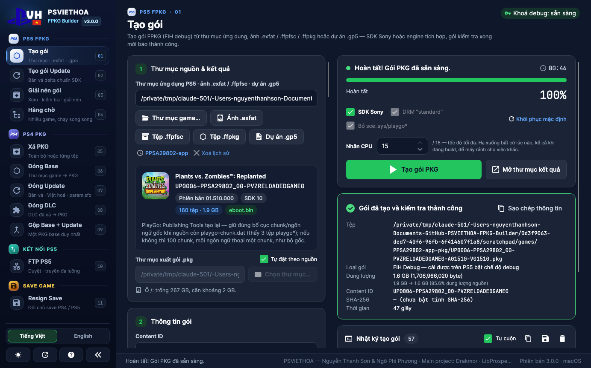
  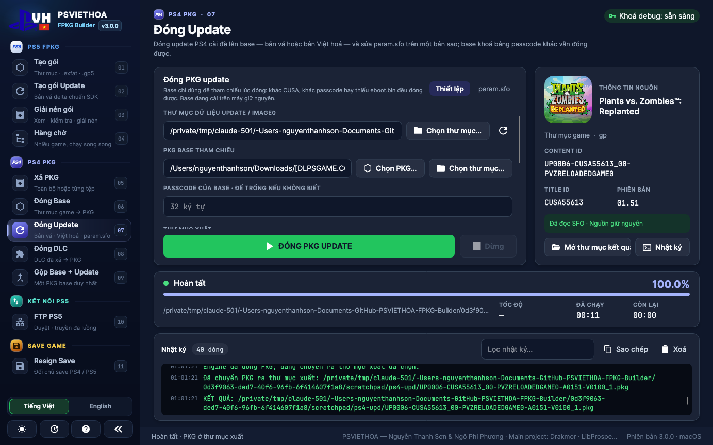
</p>
<p align="center">
  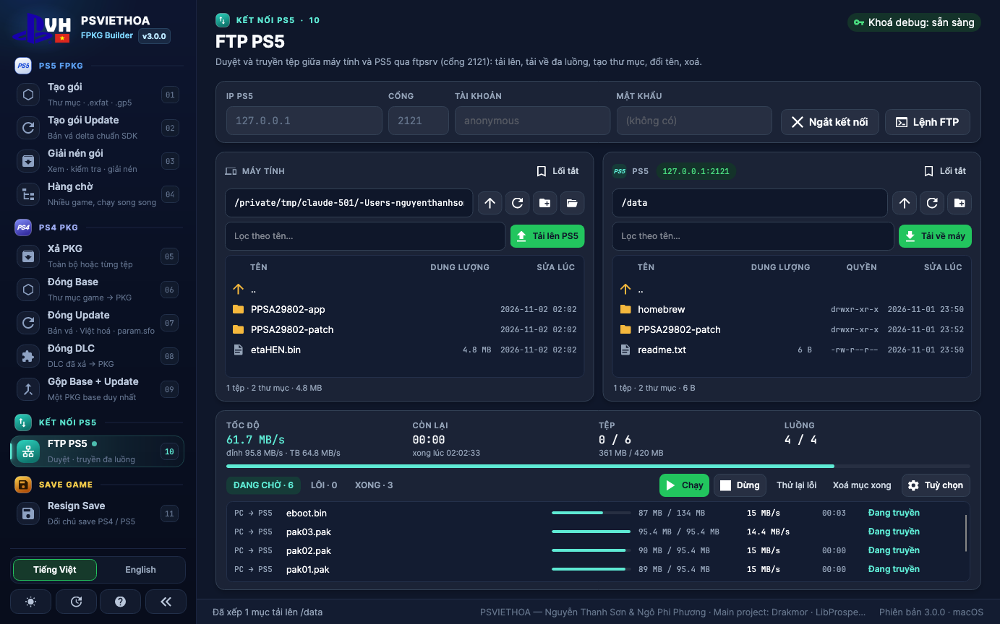
  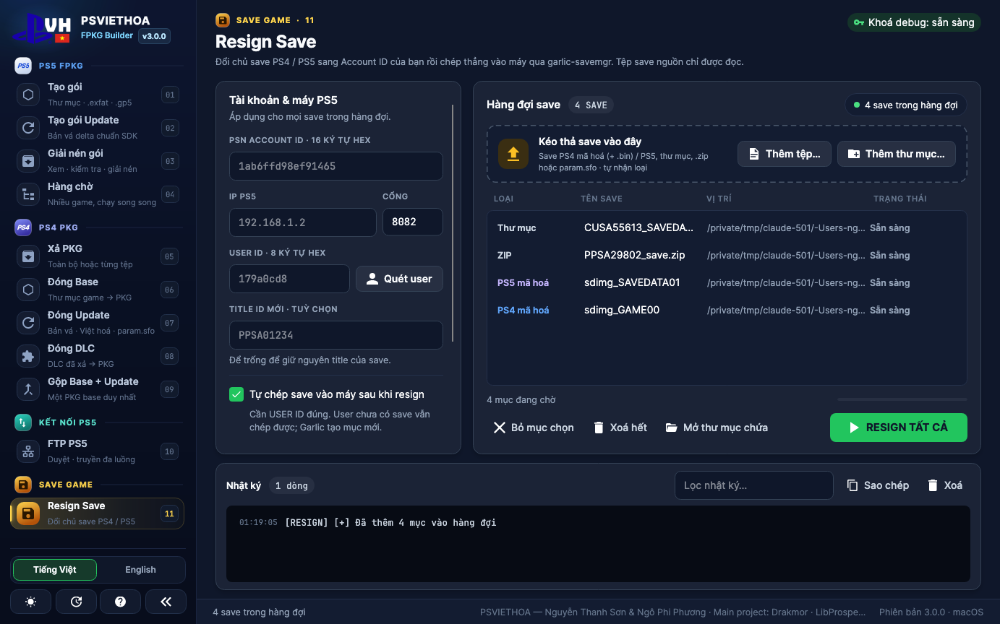
</p>

<div align="center">

**Ghi công:** PSVIETHOA — Nguyễn Thanh Sơn & Ngô Phi Phương · **Main project:** Drakmor (LibProsperoPkg) · Công cụ PS4, ZSTD, FTP và resign save chuyển từ **PSVIETHOA STUDIO** (Ngô Phi Phương)

</div>

---

## Ứng dụng có gì

| | Trang | Chức năng |
|---|---|---|
|  | **Tạo gói · Tạo gói Update · Giải nén gói · Hàng chờ** | FPKG PS5 (FIH debug) từ thư mục ứng dụng, ảnh `.exfat`, `.ffpfsc` / `.ffpfs` (exFAT hoặc PFS), `.ffpkg` hoặc dự án `.gp5` — bằng **Publishing Tools 2.79 của Sony** (mặc định) hoặc engine **LibProsperoPkg** của Drakmor. Gói update delta so với base đã cài, xem / giải nén gói, hàng chờ đóng gói song song. *Bộ công cụ SDK Sony `sdk-fpkg279-fix15`, giữ các bản sửa của 2.2.7.* |
|  | **Xả PKG · Đóng Base · Đóng Update · Đóng DLC · Gộp Base + Update** | Gói fake PKG cho PS4 bằng **orbis-pub-cmd 3.87** (bản vá CyB1K) và **LibOrbisPkg**, theo đúng quy trình của PSVIETHOA STUDIO. Xem trước game ngay (icon, tên, Content ID, phiên bản), sửa `param.sfo`, xả từng tệp. |
|  | **Đóng ZSTD · Giải ZSTD · Vá ZSTD** *(beta)* | Gói ZSTD của ps5-dump-forge với runtime **ampr-emu-ng 0.3.4**: game còn khoảng một nửa, giải ra đúng từng byte, và vá Việt hoá vào game đã đóng mà không cần giải ra. |
|  | **FTP PS5** | Trình quản lý tệp hai khung cho máy chủ FTP trên PS5 (ftpsrv, etaHEN…): kéo tệp qua lại giữa hai khung hoặc từ Finder / Explorer, truyền nhiều luồng có tiếp tục khi bị ngắt, đổi tên / xoá / tạo thư mục, nhớ máy đã kết nối. |
|  | **Resign Save** | Đổi chủ save PS4 / PS5 sang Account ID của bạn. Save đã giải mã được sửa ngay trên máy tính; save mã hoá đi qua **garlic-savemgr** trên PS5 (ứng dụng tự nạp). |

> Gói PS5 là **FPKG debug** (ảnh FIH, byte chữ ký `0x00`), gói PS4 là **fake PKG** — chỉ cài được trên máy chạy homebrew tương ứng. Thư mục, ảnh đĩa và gói nguồn bạn chọn chỉ luôn được **đọc**.

## Có gì mới ở 3.1

- **Chế độ SDK Sony dùng bộ công cụ `sdk-fpkg279-fix15` của Drakmor** (profile `sdk279-plaintext-direct-v6`), tái tạo đúng từng byte:
  - gói giữ phiên bản SDK (đọc từ `eboot.bin` khi `param.json` để 0);
  - giữ bố cục PlayGo của nguồn và chunk của từng tệp;
  - sửa / tạo lại UCP của UDS theo `npbind.dat`;
  - bỏ tệp cấu hình runtime của Unreal;
  - *Tạo theo ngôn ngữ* và chọn SDK nay dùng được với SDK;
  - bố cục kịch bản retail là tuỳ chọn (*Giữ kịch bản PlayGo retail*, mặc định tắt).

  Bản dump đặt nhầm tên bảng PlayGo (Control, PPSA29802), loại làm script fix15 dừng hẳn, vẫn tạo được gói. Các bản sửa của 2.2.7 (giữ thư mục rỗng, lấp chunk rỗng, mọi kịch bản gồm mọi chunk) vẫn bật.
- **Tạo gói PS5 từ ảnh PFS.** Tệp `.ffpfsc` chứa ảnh PFS thô (bố cục ShadowMountPlus khuyên dùng, tạo bằng MkPFS `--raw`, ps5-ffpfs-cli…), ảnh `.ffpfs` không nén và `pfs_image.dat` trần nay mở được như ảnh exFAT: xem thông tin, tạo gói, giải nén và ổ Dokan đều chạy.
- **Xả PKG PS4 nhanh hơn.** Tệp được giải mã song song (từng đoạn 4 MiB trên nhiều luồng), kèm hai bản sửa LibOrbisPkg của Studio; kết quả giống hệt từng byte.
- **ZSTD PS5 (beta)** — *Đóng ZSTD*, *Giải ZSTD* và *Vá ZSTD*: gói ZSTD của ps5-dump-forge với runtime **ampr-emu-ng 0.3.4** (game còn khoảng một nửa, thư mục nguồn không bị sửa), kiểm tra và sửa `ampr_emu.index`, vá Việt hoá vào game đã đóng mà không cần giải cả game, có hoàn tác. CLI: `zstd-info`, `zstd-list`, `zstd-pack`, `zstd-unpack`, `zstd-reindex`, `zstd-patch`, `zstd-undo`.
- **Thanh bên kiểu PSVIETHOA STUDIO.** Ô *Tìm công cụ…* (Ctrl+K / ⌘K), các nhóm theo thứ tự của Studio (PS4 PKG, PS5 FPKG, ZSTD PS5, Kết nối PS5 · Save) và lưới nút công cụ hai cột, co giãn theo cửa sổ.

Phần ảnh PFS, PS4, ZSTD và thanh bên chuyển từ PSVIETHOA STUDIO 2.1.0 của Ngô Phi Phương.

## Có gì mới ở 3.0

- **Giao diện mới.** Thanh bên thiết kế lại, gom theo máy: **PS5 FPKG**, **PS4 PKG**, **Kết nối PS5** và **Save Game**; mỗi trang có số thứ tự (01–11) và màu nhấn riêng, chế độ thu gọn chỉ còn biểu tượng. **Logo PSVH** và icon ứng dụng mới trên mọi nền tảng. Tiếng Việt là ngôn ngữ mặc định, tiếng Anh chỉ cách một cú bấm; mọi chuỗi — giao diện, nhật ký, trợ giúp CLI — đều có đủ hai thứ tiếng.
- **PS4 PKG theo đúng cách của PSVIETHOA STUDIO.** Năm trang chuyển từ PSVIETHOA STUDIO 1.7.0 của Ngô Phi Phương — cùng một cơ chế, không phải bản sao kiểu PS5:
  - **Xả PKG** mở PFS bằng passcode, hoặc khôi phục khoá FPKG khi không biết passcode (`GetEkpfs` của LibOrbisPkg, kể cả cờ tương thích KDF). Xả toàn bộ hoặc chỉ những tệp bạn tích vào thư mục `CUSAxxxxx-base / -update / -dlc` (`image0` + `Sc0`).
  - **Đóng Base / Đóng Update / Đóng DLC** tạo dự án GP4 giống hệt Studio: cùng danh sách loại trừ (`playgo-*`, `license.*`, `origin-deltainfo`, `pubtoolinfo`…), `pfs_compression` cho mọi tệp, giữ bố cục PlayGo của nguồn, `param.sfo` dàn dựng riêng với CATEGORY / APP_VER / VERSION được sửa tại chỗ. Update được trỏ về Content ID của base và mượn `nptitle` / `npbind` của base; base khoá bằng passcode khác vẫn đóng được nhờ gói tham chiếu giả. Khoá entitlement của DLC được đọc từ license debug, `dlc_rebuild.json`, GP4 hoặc `license.dat`.
  - **Gộp Base + Update** tạo một PKG base đã chứa sẵn update (tệp update được ưu tiên, keystone lấy từ base, APP_VER 01.00, VERSION lấy từ update).
  - `orbis-pub-cmd` chạy trực tiếp trên Windows và qua Wine trên macOS / Linux. **Engine nhanh** (bản vá của Studio: bỏ kiểm tra toàn vẹn gói tham chiếu và quét delta base) là mặc định; **Chế độ đầy đủ** dùng bản gốc với digest đầy đủ.
  - Khung bên phải xem trước game ngay khi chọn: icon, tên, Content ID, Title ID, phiên bản, loại và passcode có khớp không. Tab **param.sfo** sửa tên game (mọi ngôn ngữ cùng lúc), phiên bản và các trường khác trước khi đóng — bản sửa được lưu riêng, không đụng vào nguồn.
- **FTP PS5.** Kết nối tới máy chủ FTP của PS5 (tài khoản và mật khẩu mặc định để trống; mật khẩu không bao giờ được lưu). Kéo tệp / thư mục từ khung này sang khung kia, từ Finder / Explorer vào khung PS5, hoặc thả lên một thư mục để truyền thẳng vào đó; kéo tệp PS5 thả lên thư mục PS5 khác để di chuyển. Hàng đợi tự chọn số tệp song song, chia tệp lớn thành nhiều kết nối (tải về theo đoạn bằng `REST`), ước tính thời gian còn lại bằng mô hình tốc độ bình phương tối thiểu, tự thử lại / tiếp tục khi rớt mạng. Có tab Đang chờ / Lỗi / Xong, nhật ký lệnh FTP, phím tắt (Enter, Delete, F2, F5, Backspace).
- **Resign Save.** Thả thư mục, `.zip`, `param.sfo` hoặc ảnh save mã hoá; loại save được nhận theo nội dung. Save đã giải mã được resign ngay trên máy (`ACCOUNT_ID`, `TITLE_ID` tuỳ chọn, giữ bản `.bak` của `param.sfo` gốc; `.zip` được ghi ra bản `_resigned.zip` mới). Save PS4 / PS5 mã hoá được giải mã, resign và chép vào máy qua **garlic-savemgr** (earthonion): **Nạp ELF** gửi bản kèm theo tới ELF loader (cổng 9021), **Quét user** liệt kê tài khoản trên máy, **Bốc save từ user khác** chép save giữa các user trên máy, và save sắp bị ghi đè luôn được tải bản sao lưu về trước.
- **CLI:** thêm `ps4-info`, `ps4-list`, `ps4-extract`, `ps4-base`, `ps4-patch`, `ps4-dlc`, `ps4-merge`. `fpkg-cli info` báo bộ công cụ PS4 có chạy được không (Wine 32-bit / VC++ x86).
- **PS5 FPKG giữ cơ chế 2.2.7** (LibProsperoPkg của fpkg-gui 0.6.12). Riêng trang thì dễ dùng hơn: *Tự đặt theo nguồn* luôn bật, chọn game khác là thư mục xuất tự quay về theo game đó nên gói không bao giờ rơi vào thư mục của game trước; cột phải cuộn được nên nhật ký luôn đọc được (cao tối thiểu 280 px) khi khung kết quả đang hiện; các nút ghi rõ chọn gì (*Thư mục game…*, *Chọn PKG…*, *Chọn thư mục…*).

Các bản trước: xem [CHANGELOG.md](../CHANGELOG.md) — dòng 2.2 mang đến đóng gói bằng Publishing Tools của Sony, gói update, hàng chờ, khôi phục metadata online và các bản sửa PlayGo / bộ giả lập DLC.

## Tải về & chạy

Tải bản cho máy của bạn ở trang [**Releases**](https://github.com/thanhsondev/PSVIETHOA-FPKG-Builder/releases/latest). Mọi bản đều **tự chứa** (không cần cài .NET) và có kèm công cụ dòng lệnh `fpkg-cli`.

| Nền tảng | Tệp | Ghi chú |
|---|---|---|
| **macOS** Apple Silicon / Intel | `…-macOS-AppleSilicon.zip` / `…-macOS-Intel.zip` | Lần đầu chuột phải vào ứng dụng → **Open** (ký ad-hoc). Đã kèm Wine (có hỗ trợ 32-bit cho PS4). Apple Silicon cần Rosetta 2 — ứng dụng đề nghị cài giúp. |
| **Windows** x64 | `…-Windows-x64-Setup.exe` hoặc `.zip` | Bộ cài kèm Dokan (gắn ảnh không sao chép) và runtime Visual C++: x64 cho SDK Sony, **x86 2008 SP1 + 2015–2022 cho PS4**. Bản zip portable tự cài phần còn thiếu ở lần dùng đầu (hỏi UAC). |
| **Linux** x64 / arm64 | `…-Linux-x64.tar.gz` / `…-Linux-arm64.tar.gz` | Chạy `app/PsViethoa.FpkgBuilder.App` (`./install-desktop-entry.sh` thêm vào menu). SDK Sony và PS4 dùng Wine của distro — riêng PS4 cần Wine có hỗ trợ 32-bit (`wine32` / `wine:i386`). |

## Dùng nhanh

**PS5 FPKG** — *Tạo gói*: chọn thư mục ứng dụng (hoặc `.exfat` / `.ffpfsc` / `.ffpkg` / `.gp5`), kiểm tra Content ID và phiên bản đọc được, bấm **Tạo gói PKG** (`Ctrl/⌘+B`). Gói được kiểm tra xong mới báo hoàn tất. *Tạo gói Update* làm tương tự so với gói base đã cài trên máy.

**PS4 PKG** — chọn trang (Xả / Base / Update / DLC / Gộp), thả `.pkg` hoặc thư mục game nguồn (cùng base với Update / Gộp). Khung xem trước tự điền, thư mục xuất được đặt cạnh nguồn, bấm nút xanh (*Bắt đầu xả PKG*, *Đóng PKG base*…). Cần đổi phiên bản hay tên game thì sửa ở tab *param.sfo* trước.

**FTP PS5** — bật máy chủ FTP trên PS5 (ftpsrv dùng cổng 2121; máy chủ khác thì nhập đúng cổng của nó), nhập IP, **Kết nối**, rồi kéo thả tệp.

**Resign Save** — nhập Account ID 16 ký tự (thêm IP PS5 + User ID nếu cần chép save mã hoá vào máy), thả save vào, **Resign tất cả**.

## Dòng lệnh

```bash
fpkg-cli info                                        # thành phần nào chạy được trên máy này (SDK, Wine, công cụ PS4, khoá…)

# PS5 FPKG
fpkg-cli build --source "/games/PPSA12345-app" --output "/out"
fpkg-cli build --source "/games/PPSA12345-update" --sdk-reference "/out/PPSA12345-base.pkg" --output "/out"
fpkg-cli pkg-extract "/out/UP9000-PPSA12345_00-XXXX-A0100-V0100.pkg" --output "/unpacked" --include "sce_sys/**"

# PS4 PKG
fpkg-cli ps4-info  "/games/CUSA12345.pkg"
fpkg-cli ps4-extract "/games/CUSA12345.pkg" --output "/unpacked"
fpkg-cli ps4-base  "/unpacked/CUSA12345-base" --output "/out"
fpkg-cli ps4-patch "/unpacked/CUSA12345-update" --base "/games/CUSA12345.pkg" --output "/out" --version 01.51
fpkg-cli ps4-merge "/games/CUSA12345-patch.pkg" --base "/games/CUSA12345.pkg" --output "/out"
fpkg-cli ps4-dlc   "/unpacked/CUSA12345-dlc" --output "/out"

# ZSTD PS5 (beta)
fpkg-cli zstd-pack   "/games/PPSA12345-app" --output "/games/PPSA12345-zstd"
fpkg-cli zstd-unpack "/games/PPSA12345-zstd" --output "/games/PPSA12345-app"
```

`fpkg-cli --help` liệt kê mọi tuỳ chọn (`--verify` dùng engine PS4 đầy đủ, `--gp4-only`, `--only <đường dẫn>`, `--sfo <tệp>`, `--passcode`, `--base-passcode`, `--entitlement-key`, …). Mã thoát: `0` thành công · `1` tham số sai · `2` thất bại · `3` bị hủy. Đặt `FPKG_LANG=vi|en` để chọn ngôn ngữ.

## Đã test với game thật

Mọi ảnh dưới đây là lần chạy thật của bản này trên Mac Apple Silicon (macOS 27, Wine kèm theo), với chính bản dump của chủ dự án.

**PS5 — Plants vs. Zombies Replanted (`PPSA29802`, 1,9 GB, 160 tệp), đóng gói bằng SDK Sony**

| Đã tạo và kiểm tra thành công | Nhật ký (cuộn xuống) |
|---|---|
|  | 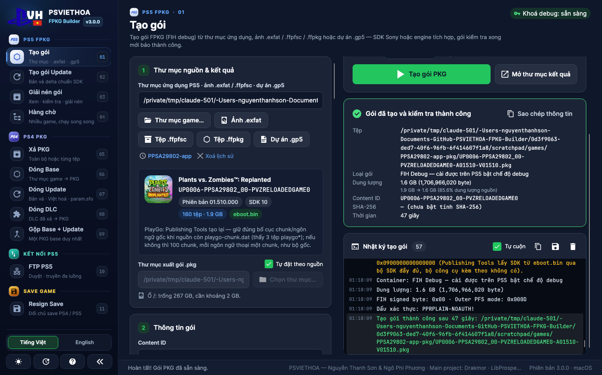 |

Gói 1,6 GB (1.706.966.020 byte), qua đủ 6 bước kiểm tra gói. CLI, giao diện và bản 2.2.7 cho ra cùng kích thước.

**PS4 — Plants vs. Zombies Replanted (`CUSA55613`, base 1.00 + update 1.51), orbis-pub-cmd qua Wine**

| Đóng Update (từ update 1.51 đã xả + PKG base) | Gộp Base + Update |
|---|---|
|  | 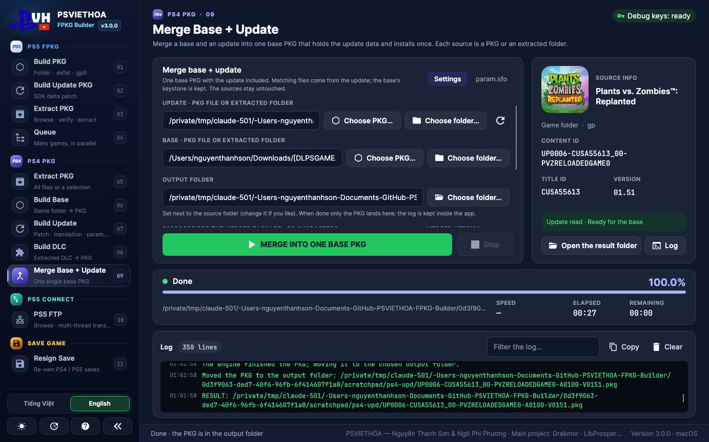 |

| Tác vụ | Kết quả | Thời gian |
|---|---|---|
| FPKG PS5, SDK Sony | `PPSA29802` → gói 1,6 GB, đã kiểm tra | 47–52 giây |
| Xả PKG PS4 | base 1,75 GB → 351 tệp (update 156 MB → 34 tệp) | 7 giây |
| Đóng Update PS4 | PKG update 161.873.920 byte, nội dung giống update 1.51 gốc | 12 giây |
| Đóng Base PS4 | PKG base 1.748.697.088 byte | 15 giây |
| Gộp Base + Update PS4 | một PKG base 1.748.697.088 byte đã chứa 1.51 (APP_VER 01.00, VERSION 01.51) | 27 giây |
| FPKG PS5, engine tích hợp, Tiêu chuẩn | game 21,3 GB → 8,86 GiB (số đo từ bản 2.1) | 2 phút 13 giây |

Các tệp xả ra giống bản gốc, trừ những tệp công cụ đóng gói tự tạo lại; các PKG nguồn giữ nguyên SHA-256. FTP và resign save được thử với máy chủ FTP chạy trên máy và save mẫu (khi chụp các ảnh này không nối PS5).

## Build từ mã nguồn

Cần [.NET SDK 10](https://dotnet.microsoft.com/download).

```bash
dotnet build PsViethoa.FpkgBuilder.slnx -c Release
dotnet test                                          # hơn 550 test (đóng gói thật bằng SDK Sony / PS4 chạy khi có Wine và bộ công cụ)
scripts/run-dev.sh                                   # giao diện bản Debug (macOS / Linux)
scripts/fetch-wine.sh                                # Wine cho SDK Sony và công cụ PS4 trên macOS (giữ thư viện 32-bit)

scripts/publish-macos.sh osx-arm64 osx-x64           # .app + fpkg-cli + Wine + sony-sdk + orbis-pub, nén zip
scripts/publish-windows.sh                           # exe, fpkg-cli, sony-sdk, orbis-pub, Dokan + VC++ x64/x86, Setup.exe nếu có makensis
scripts/publish-linux.sh linux-x64 linux-arm64       # tar.gz gồm app/, fpkg-cli/, sony-sdk/, orbis-pub/
```

<details>
<summary>Cấu trúc dự án</summary>

```
src/PsViethoa.FpkgBuilder.Core/     engine PS5 & quy trình SDK Sony, Ps4/ (LibOrbisPkg + orbis-pub-cmd), Ftp/, Saves/, bản dịch
src/PsViethoa.FpkgBuilder.App/      giao diện Avalonia (MVVM): khung thanh bên, các trang PS5 / PS4 / FTP / Save
src/PsViethoa.FpkgBuilder.Cli/      fpkg-cli
tests/PsViethoa.FpkgBuilder.Tests/  xUnit, chỉ dùng dữ liệu tổng hợp
libs/                               thành phần bên thứ ba, chỉ thay nguyên khối:
  LibProsperoPkg.dll                  engine PS5 (Drakmor)
  sony-sdk/                           bộ công cụ Publishing Tools 2.79
  LibOrbisPkg/                        PKG / PFS / SFO PS4 (Maxton, LGPL-3.0, kèm mã nguồn)
  orbis-pub/                          PS4 Fake PKG Tools 3.87 (CyB1K), bản gốc + engine nhanh
  garlic-savemgr/                     payload save PS5 (earthonion), kèm mã nguồn
  ampr/                               runtime ampr-emu-ng 0.3.4 + ampr_emu 0.4.2.1 cho gói ZSTD (GPL-3.0-or-later)
```
</details>

## Ảnh chụp

| PS5 — Tạo gói xong (tiếng Anh) | PS4 — xem trước game (tiếng Anh) |
|---|---|
| 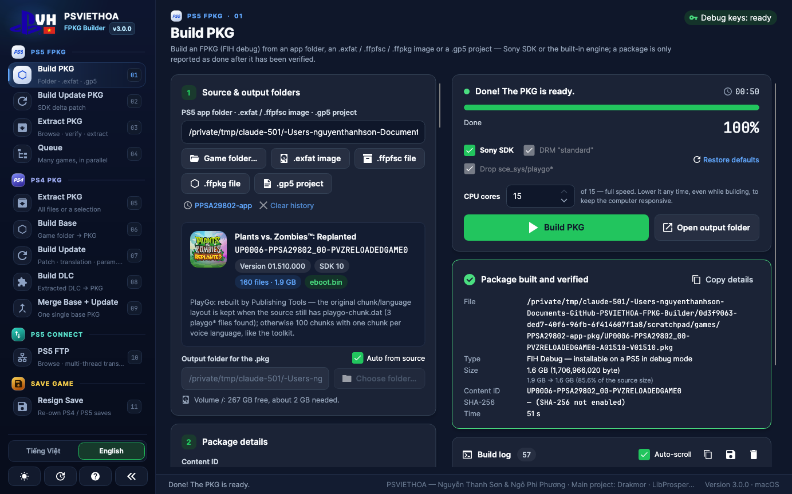 | 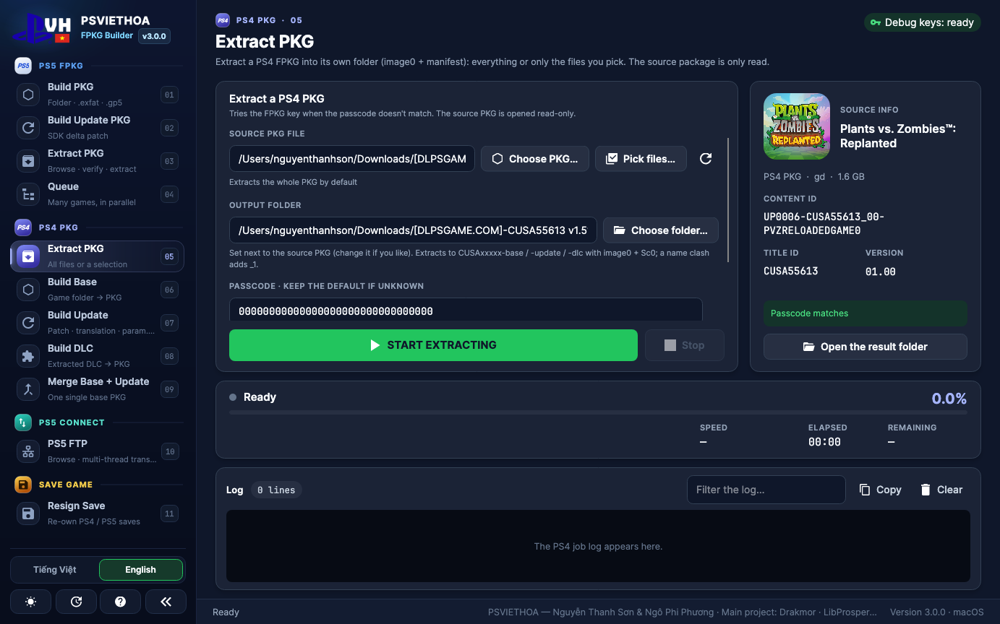 |

| PS4 — sửa param.sfo | FTP PS5 (tiếng Anh) |
|---|---|
| 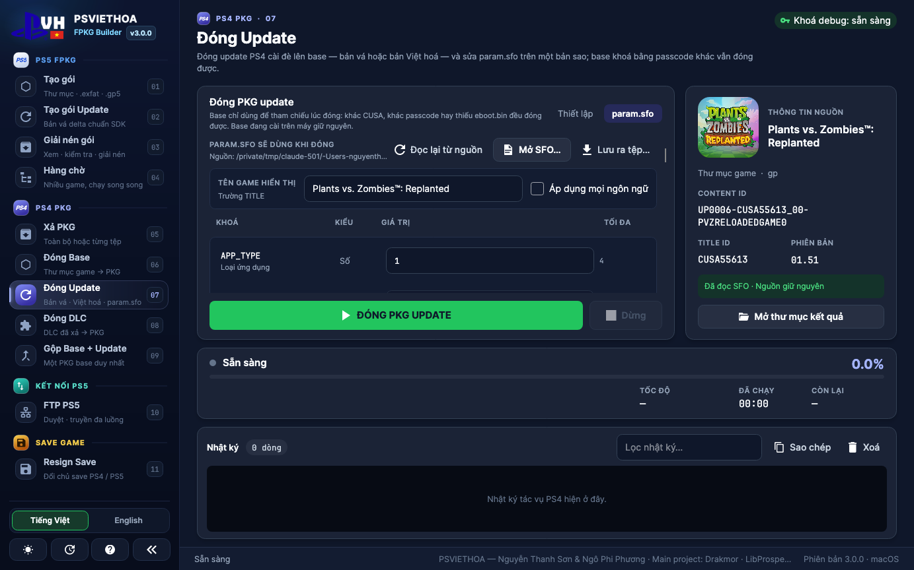 | 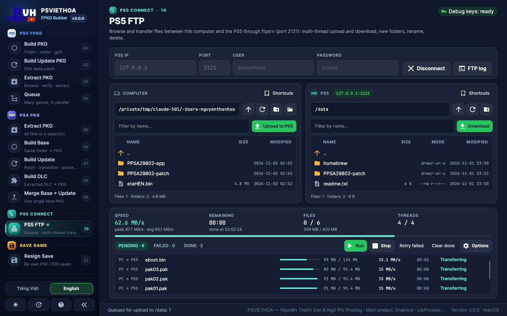 |

| Resign save xong (tiếng Anh) | Giao diện sáng |
|---|---|
| 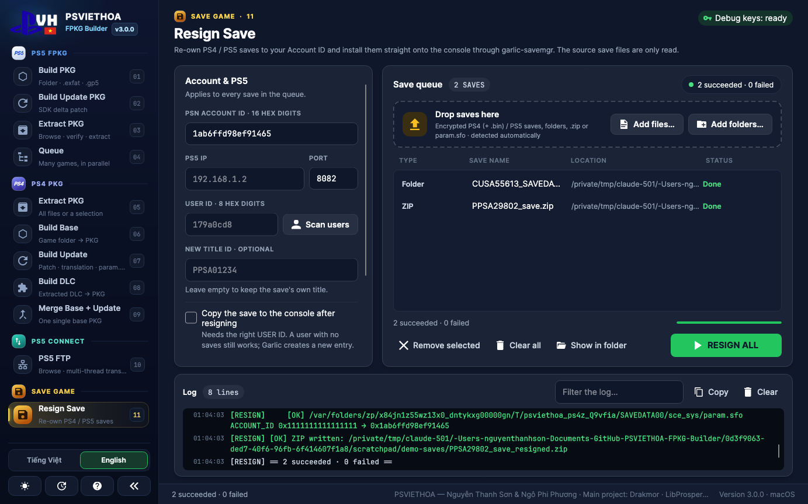 | 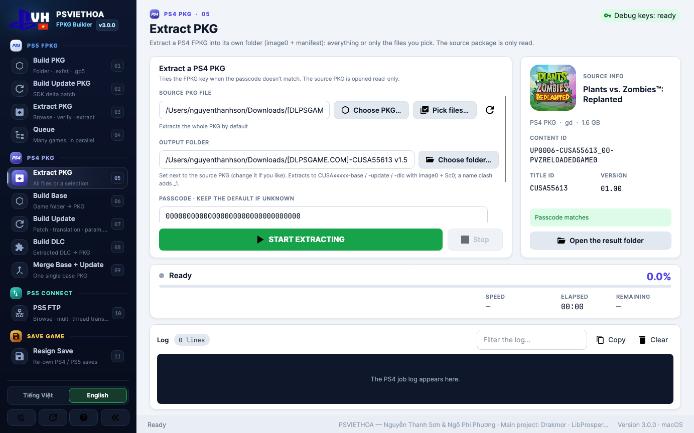 |

| Hướng dẫn — ghi công |
|---|
| 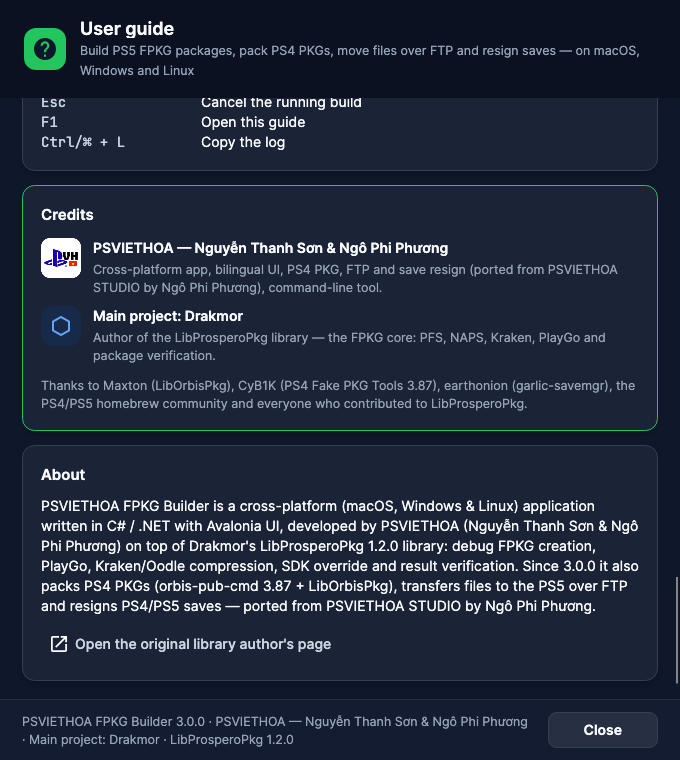 |

## Ghi công & giấy phép

- **PSVIETHOA — Nguyễn Thanh Sơn & Ngô Phi Phương** — ứng dụng đa nền tảng, giao diện, quy trình SDK Sony, CLI. Cơ chế PS4 PKG, FTP và resign save lấy từ **PSVIETHOA STUDIO** của **Ngô Phi Phương**.
- **Main project: Drakmor** — **LibProsperoPkg**, engine FPKG PS5 (PFS, NAPS, Kraken, PlayGo, kiểm tra gói).
- **Maxton** — [LibOrbisPkg](https://github.com/maxton/LibOrbisPkg) (LGPL-3.0; DLL được liên kết như một assembly riêng, mã nguồn kèm trong `libs/LibOrbisPkg`).
- **CyB1K** — PS4 Fake PKG Tools 3.87 (`orbis-pub-cmd`).
- **earthonion** — garlic-savemgr (payload save PS5).
- **quer3q** — [ps5-dump-forge](https://github.com/quer3q/ps5-dump-forge) (định dạng gói ZSTD) và [ampr-emu-ng](https://github.com/quer3q/ampr-emu-ng); **drakmor** — [ampr_emu](https://github.com/drakmor/ampr_emu). Tất cả GPL-3.0-or-later; runtime được giữ nguyên trong `libs/ampr`.
- [Wine](https://www.winehq.org/) (LGPL-2.1) chạy bộ công cụ Windows trên macOS / Linux; [Dokan](https://github.com/dokan-dev/dokany) gắn ảnh đĩa trên Windows.
- Phông chữ: JetBrains Mono & Inter (SIL OFL). Biểu tượng: Material Design Icons (Apache 2.0).

> Các tệp bên thứ ba trong `libs/` được giữ nguyên (engine nhanh PS4 là bản vá có ghi rõ của Studio, `FAST_ENGINE_PATCH.json`). Công cụ dành cho homebrew và phát triển trên máy của chính bạn — hãy dùng có trách nhiệm.

<div align="center">

Làm bằng cả tấm lòng bởi **PSVIETHOA** · 🇻🇳 · [psviethoa.com](https://psviethoa.com)

</div>
